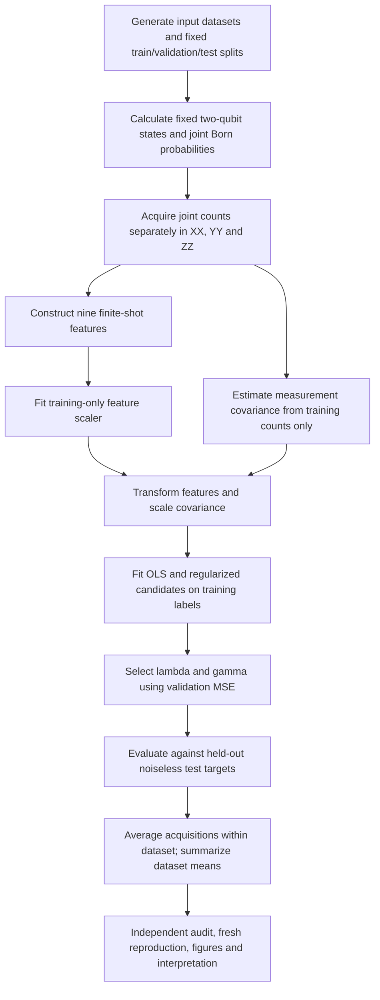

# Team Outliers: presentation and viva guide

**Project:** Measurement-Aware Regularization in Finite-Shot Quantum Feature Regression

**Team:** Kartik Mehra and Viraj Chafale

**Presentation:** 25 November 2026

**Scope:** completed semester implementation and evaluation; this guide covers both the preserved original baseline and the fresh four-method extension.

## 1. Read this first

We built a CPU simulation of a fixed two-qubit quantum feature map. We compared four classical regression readouts using identical finite-shot measurements: OLS, Ridge, DiagonalCov and FullCov. The extension estimates measurement uncertainty from training counts and adds it to the readout penalty.

**The central finding is mixed:** increasing shots reduced mean error in our evaluated settings, but FullCov beat the stronger Ridge baseline in only **one of six primary finite-shot conditions**, by approximately **0.71%**. It was slightly worse in the other five. This is an implementation and controlled evaluation of existing principles, not a new quantum algorithm or evidence of quantum advantage.

Keep these distinctions clear throughout the viva:

- The quantum circuit is fixed; the classical readout is trained.
- Shot noise exists even in an ideal circuit; hardware noise is not simulated.
- Twenty independent datasets are the extension's dataset-level repetitions. Thousands of fitted models are not thousands of independent datasets.
- Mean differences and sample SDs are descriptive; we make no statistical-significance claim.
- A method implemented as an extension need not improve accuracy. Its outcome is determined by the evaluation.

## 2. Thirty-second pitch

> Our project studies how limited quantum measurements affect machine-learning predictions. A fixed two-qubit circuit converts an input into nine measured features. We compare ordinary regression, Ridge, and two regularizers that use estimated measurement variance or covariance. We evaluated them on twenty fresh datasets with shared measurements and validation-only tuning. More shots reduced error, but covariance regularization did not consistently improve on Ridge. Our contribution is a verified implementation, a fair comparison, and an honest account of when the added complexity did not help.

## 3. Five-minute presentation script

The saved deck has six slides including the cover. Its main slides use plain-language explanations, with equations kept in this guide and the speaker-note backups. Use the short spoken explanations below; `presentation/speaker_notes.txt` contains the current slide-by-slide script with separate “Say” and “If asked” sections.

| Slide | Time | What to explain | Transition |
|---|---:|---|---|
| 1. Title | 25 seconds | Introduce Team Outliers and the project. State that we study measurement uncertainty in quantum-feature regression. | “First, what problem do limited measurements create?” |
| 2. Why limited measurements matter | 45 seconds | A shot is one circuit execution and measurement. Limited shots give fluctuating feature estimates. The workflow is input, fixed circuit, measured features, classical readout. Ask whether uncertainty-aware regularization improves on Ridge. | “Here is the circuit and how we measured its output.” |
| 3. Circuit and test setup | 60 seconds | Two qubits, fixed rotations and entangling gates. XX, YY and ZZ produce nine features. Budgets are 32, 128 or 512 shots **per setting**, so cost is 3S per input. Explain the two targets and the 64/32/128 split. Twenty datasets each have five acquisitions. | “We keep this measurement data identical across four readouts.” |
| 4. Four ways to fit the same features | 60 seconds | OLS has no penalty; Ridge shrinks weights; DiagonalCov uses individual feature variances; FullCov also uses shared fluctuations. The covariance and scaler use training data only. Validation selects penalties, with 32 candidates per regularized method. | “The held-out results determine whether that extra structure helps.” |
| 5. Results: more shots gave lower error | 60 seconds | Lower MSE is better. The two panels have different vertical ranges. All four curves drop with shots and nearly overlap. These are means over twenty datasets after averaging acquisitions. SDs are in the report. | “To see the small method differences, we compare FullCov directly with Ridge.” |
| 6. What we learned | 50 seconds | Positive bars favour FullCov. Only mixed harmonics at 512 shots improves, by 0.71%. State the limited scope and a future shrinkage experiment on fresh held-out data. | “Our conclusion is a reproducible, controlled evaluation with mixed findings.” |

Suggested speaking split: Kartik explains slides 1–3 and Viraj explains slides 4–6, **if both team members are comfortable with that division**. This is a presentation suggestion, not a record of who implemented which component. Both members should understand the complete pipeline.

## 4. Why this project is needed

A simulator can directly calculate exact expectation values. A quantum processor returns random measurement outcomes; expectations must be estimated using repeated shots. Measurement resources are finite, and feature uncertainty can affect a fitted model.

Ridge provides a strong simple baseline. A covariance penalty offers a more structured alternative: it discourages weights that amplify estimated measurement fluctuations. The practical question is whether that structure helps enough to justify its additional estimation and selection steps.

The semester project makes this question concrete and measurable. It connects quantum measurement statistics, classical supervised learning, experimental design, reproducibility and failure analysis. It does not establish a production application or show that a quantum computer is needed for these synthetic functions.

## 5. Domain, inputs, outputs and boundaries

| Question | Answer |
|---|---|
| Domain | Quantum machine learning; fixed quantum feature maps with classical regression; finite-shot uncertainty and regularization |
| Learning type | Supervised regression |
| Input | One real number x, sampled uniformly on [-pi, pi] |
| Targets | sin(x), or sin(2x) + 0.3 cos(3x) |
| Quantum output | Nine expectation-value estimates derived from three measurement settings |
| Learned output | A continuous prediction y_hat = b + w^T z |
| Learned parameters | Nine classical weights and one intercept; lambda/gamma selected using validation data |
| Not learned | Quantum gate constants, circuit architecture and measurement settings |
| Execution | Classical CPU statevector simulation plus Born-rule multinomial sampling |
| Hardware/GPU | Neither is required or used for the reported experiment |
| Project outcome | Runnable simulation, four readouts, saved models, raw counts, audits, results, report and presentation materials |

## 6. End-to-end workflow



The held-out test targets never choose penalties. There is no train-plus-validation refit after selection. All methods share the measurement records for each condition. Clean and noisy-label evaluations remain separate.

## 7. Circuit and measurements

### Exact gate sequence

Start in |00>, using the basis order |q0 q1> = |00>, |01>, |10>, |11>. Qubit 0 is the most significant bit.

1. Apply RY(x), then RZ(0.4x), on q0.
2. Apply RY(2x + 0.3), then RZ(-0.7x), on q1.
3. Apply CNOT with q0 controlling q1.
4. Apply RY(0.7) on q0.
5. Apply RY(-0.4), then RZ(0.2), on q1.
6. Apply CZ on q0 and q1.
7. Acquire independent XX, YY and ZZ measurement settings.

RY rotates the state around the Bloch sphere's y axis; RZ changes relative phase through a z rotation. CNOT conditionally flips the target, and CZ changes the phase of |11>. These gates can create correlations and entanglement; do not claim that every input state is entangled or that entanglement caused an accuracy improvement.

X-basis measurement applies H before computational measurement. Y applies S-dagger followed by H. Z needs no rotation. Matrices act on vectors right-to-left, so the Y rotation matrix is H @ SDG.

### Nine features from two qubits

For one setting, each joint bitstring becomes signs z0,z1 in {-1,+1}. The same shot supplies three values: z0, z1 and z0*z1. Averaging gives two singles and one pair expectation.

| Setting | Features |
|---|---|
| XX | X0, X1, X0X1 |
| YY | Y0, Y1, Y0Y1 |
| ZZ | Z0, Z1, Z0Z1 |

We estimate expectations using the actual joint distribution, not nine independent Gaussian perturbations. Shared-shot correlations are preserved. Separate settings use independent acquisitions; incompatible X/Y/Z measurements are not all read from a single copy of the state.

For S shots per setting, one input costs 3S simulated executions: 96, 384 or 1,536 at the three budgets. This is a simulated resource ledger, not physical QPU use.

## 8. Important definitions

| Term | Plain meaning in this project |
|---|---|
| Qubit | Quantum system whose pure state is a normalized complex combination of two basis states |
| Statevector | Complex amplitudes of the full two-qubit state; squared magnitudes give measurement probabilities in the chosen basis |
| Born rule | The rule connecting quantum amplitudes to measurement probabilities |
| Observable | Measurable quantity, here Pauli singles or pair products with outcomes +/-1 |
| Expectation value | Probability-weighted mean of an observable's outcomes |
| Shot | One preparation, circuit execution and measurement in one setting |
| Shot noise | Sampling fluctuations because expectations use finitely many outcomes |
| Feature map | Transformation from input x to a vector used by a predictor |
| Readout | Classical model mapping the nine features to a prediction |
| Regression | Predicting a continuous numerical target |
| OLS | Ordinary least squares; fits squared error without a regularization penalty |
| Ridge | Least squares plus an L2 coefficient penalty |
| Regularization | A constraint or penalty that trades training fit against a chosen form of model complexity or sensitivity |
| Bias–variance tradeoff | Shrinkage can introduce systematic error while reducing sensitivity to fluctuating data; a gain is not guaranteed |
| Variance | Average squared fluctuation of one random quantity about its mean |
| Covariance | Joint fluctuation of two quantities; it may be positive or negative |
| Measurement covariance | Conditional covariance of feature-estimation errors at a fixed input |
| Feature covariance across inputs | Variation of feature values as x changes; different from measurement covariance |
| Off-diagonal entries | Covariances between different features, retained within settings by FullCov |
| PSD matrix | Positive semidefinite: w^T C w is nonnegative for every w |
| Standardization | Subtract training feature means and divide by training scales |
| Hyperparameter | A value chosen outside the fitted weights, here lambda or gamma |
| Validation set | Data used to select hyperparameters |
| Test set | Held-out data used to assess the selected model |
| Leakage | Letting held-out information influence fitting or selection inappropriately |
| Acquisition | A repeated simulated measurement draw; multiple acquisitions can share the same input dataset |
| Seed | Reproducible initialization for pseudo-random generation |
| Ablation | Controlled removal of a component; DiagonalCov removes FullCov's off-diagonal terms |
| MSE | Mean squared error: average of (prediction - target)^2; lower is better |
| SD | Sample standard deviation describing dispersion, here across dataset-level means |
| Confidence interval | An inferential interval; the plotted SD bars are not confidence intervals |
| Exact reference | Simulator-computed expectations without shot sampling; a diagnostic rather than free hardware measurements |
| Quantum advantage | A supported advantage against suitable classical alternatives; not assessed here |

## 9. Mathematics you should be able to explain

### Feature uncertainty

For one +/-1 observable with conditional expectation f(x), independent shots give:

`Var(f_hat_S | x) = [1 - f(x)^2] / S`.

More shots reduce the variance of this feature estimate. This identity does not prove that every trained model's test error decreases monotonically.

### Covariance estimator

For a fixed input and setting, let `v_s = (z0, z1, z0*z1)` and `m = mean_s(v_s)`. The unbiased sample covariance of the estimated mean is:

`C_mean = [sum_s(v_s v_s^T) - S*m*m^T] / [S*(S-1)]`.

It equals sample covariance of single-shot vectors divided by S. The four joint outcome counts reconstruct both sums, so no extra quantum acquisition is needed. At least two shots are required.

The three independent settings produce a 9x9 block-diagonal matrix with three 3x3 blocks. Average these matrices across training inputs only. Under feature scaling with diagonal scale matrix D:

`C_z = D^-1 * average_training_C * D^-1`.

DiagonalCov retains only C_z's diagonal; FullCov retains the within-setting blocks. Tiny negative numerical eigenvalues down to the specified tolerance are clipped; eigenvalues below -1e-12 trigger an error. This is a numerical safeguard, not arbitrary removal of measured correlations.

### Readout objectives

`z = (features - training_mean) / training_scale`

`prediction = b + w^T z`

| Model | Training objective |
|---|---|
| OLS | mean squared training error |
| Ridge | mean squared training error + lambda * ||w||^2 |
| DiagonalCov | mean squared training error + lambda * ||w||^2 + gamma * w^T diag(C_z) w |
| FullCov | mean squared training error + lambda * ||w||^2 + gamma * w^T C_z w |

The intercept b is unpenalized. The quadratic term represents the estimated measurement-noise variance propagated through the linear readout under the chosen covariance approximation. It is an empirical penalty, not an unbiased correction for noisy features or a generalization guarantee.

The covariance models center z and y and solve a regularized linear system. Ridge uses scikit-learn's SVD solver. Because scikit-learn uses a summed squared loss, the code sets `alpha = n_train * lambda` to match the mean-loss convention.

Gamma zero recovers Ridge **at the same lambda**. With exact features C_z is zero: differences from the independently tuned Ridge reference then reflect the candidate grid, not a covariance benefit.

## 10. Experimental design and fair comparison

| Design choice | Original study | Fresh extension |
|---|---|---|
| Models | OLS, Ridge | OLS, Ridge, DiagonalCov, FullCov |
| Independent datasets | 5 | 20 |
| Dataset seeds | 11,22,33,44,55 | 1001–1020 |
| Acquisitions per finite-shot dataset/budget | 5 | 5 |
| Acquisition seed labels | 101,202,303,404,505 | 2101–2105 |
| Splits | 64 train / 32 validation / 128 test | Same |
| Targets | Sine, mixed harmonics | Same |
| Shots/setting | 32,128,512; exact reference | Same |
| Label conditions | Clean; separate train/validation noise SD 0.1 | Same |
| Ridge candidates | 8 lambdas | 32 lambdas |
| Covariance candidates | Not implemented | 8 lambdas x 4 gammas = 32 per method |
| Recorded evaluated readouts | 600 finite + 40 exact = 640 | 4,800 finite + 320 exact = 5,120 |

The stronger extension Ridge grid is the union of 26 log-spaced lambdas from 1e-6 to 10 and the original eight values, with duplicate endpoints removed. It includes all gamma-zero options available to the covariance models. The covariance lambdas are `[1e-6,1e-5,1e-4,1e-3,0.01,0.1,1,10]`; gammas are `[0,0.1,1,10]`.

Matching candidate count does not make grid resolution or family complexity identical. DiagonalCov and FullCov share identical grids, making their ablation more directly controlled. Validation ties prefer smaller gamma then smaller lambda; Ridge ties prefer smaller lambda.

The extension protocol was recorded before the fresh evaluation. Original and extension results remain separate: different dataset seeds and a different Ridge grid mean that cross-phase score changes cannot be attributed solely to covariance regularization.

Primary labels are noiseless. The separate sensitivity condition adds Gaussian noise of SD 0.1 only to training and validation labels. **Test targets are always the noiseless functions**, so the metric assesses latent-function estimation.

### Counts and uncertainty

For finite shots, `20 datasets x 5 acquisitions x 2 tasks x 2 label conditions x 3 budgets x 4 methods = 4,800` readouts. Exact references have `20 x 2 x 2 x 4 = 320`; they are not repeated across acquisition seeds.

The 124,160 internal candidate fits include OLS. They are computational work, not independent statistical trials. There are 300 unique dataset/acquisition/budget measurement acquisitions. Tasks, label conditions, methods and candidates reuse these records.

The extension shot ledger is:

`20 * 5 * (64+32+128) * 3 * (32+128+512) = 45,158,400`.

Count generation samples multinomial outcomes directly; this number is not a runtime measurement or a claim that a physical processor executed that many circuits.

Average the five acquisition MSEs within each dataset first. Then report mean and sample SD over the twenty dataset means. Paired comparisons subtract errors on common records before this aggregation. Positive `reference - candidate` favours the candidate.

## 11. Actual findings to memorize

### Primary clean-label finite-shot mean test MSE

| Target | Shots/setting | OLS | Ridge | DiagonalCov | FullCov | FullCov reduction vs Ridge |
|---|---:|---:|---:|---:|---:|---:|
| Sine | 32 | 0.045718 | 0.045066 | 0.045272 | 0.045170 | -0.23% |
| Sine | 128 | 0.014218 | 0.014126 | 0.014235 | 0.014232 | -0.76% |
| Sine | 512 | 0.004031 | 0.003990 | 0.003966 | 0.004004 | -0.35% |
| Mixed harmonics | 32 | 0.095369 | 0.093236 | 0.093350 | 0.093780 | -0.58% |
| Mixed harmonics | 128 | 0.028590 | 0.028609 | 0.028656 | 0.028643 | -0.12% |
| Mixed harmonics | 512 | 0.009048 | 0.009101 | 0.009018 | 0.009036 | +0.71% |

These are rounded means, not means plus SD. Full precision, SDs and paired contrasts are in `results/measurement_extension/summary.json`; the IEEE report includes primary mean +/- SD values.

- **More shots:** lower mean error for all four readouts on both primary targets in these settings.
- **FullCov versus Ridge:** better in 1/6 primary settings; slightly worse in 5/6.
- **FullCov versus DiagonalCov:** better in 3/6 primary settings; correlations give no consistent benefit here.
- **Gamma zero:** selected by FullCov in 43–57% of individual primary dataset/acquisition fits, depending on condition. Turning off the term is not evidence that covariance helped.
- **Noisy-label sensitivity:** FullCov beats Ridge in 4/6 finite-shot means; differences are small and mixed. This does not replace the primary clean-label result.
- **Exact reference:** zero covariance; differences between the covariance methods and Ridge arise from their lambda grids.
- **Original baseline:** Ridge improved 5/6 clean finite-shot means but worsened mixed harmonics at 32 shots. That result belongs to the older, separate study.

Relative reduction is `100 * (Ridge mean MSE - FullCov mean MSE) / Ridge mean MSE`. A negative value is a deterioration. A 0.71% relative error reduction is not a 0.71 percentage-point increase in classification accuracy.

### How to read the figures

| Figure | Explanation |
|---|---|
| `figures/quantum_circuit.png` | Exact fixed circuit and independent measurement settings |
| `figures/feature_precision.png` | Original study's feature-estimation precision; distinguish this from prediction accuracy |
| `figures/measurement_extension/test_mse_clean.png` | Four primary MSE curves with descriptive dataset-level SD bars; near overlap is a real outcome |
| `figures/measurement_extension/paired_differences_clean.png` | Small method differences on shared records; positive favours the candidate; SD bars are not confidence intervals |
| `figures/measurement_extension/test_mse_noise_0.1.png` | Separate noisy-label sensitivity, not the primary condition |
| `figures/measurement_extension/nonzero_covariance_selection.png` | How often validation selected a nonzero gamma |

The original `figures/workflow.png` describes the two-method phase. Use the workflow in the current report/deck or Section 6 above to explain the full extension.

## 12. Why might covariance regularization fail to improve?

The results do not isolate a single cause. Plausible explanations to test include:

1. Covariance estimated from finite training shots can itself be uncertain.
2. Ridge may already control much of the sensitivity relevant to these targets.
3. Extra shrinkage can add bias and suppress useful signal.
4. Only 32 validation inputs select among penalty candidates.
5. Adding gamma increases selection complexity; lambda resolution also differs from Ridge.
6. This circuit, task family and data size may not be a setting where measured correlations improve prediction.

Present these as hypotheses, not established causal diagnoses. The covariance implementation is independently checked, but correctness does not imply superiority. Do not select a convenient seed or change the method after seeing the test results and call that a fresh validation.

## 13. Implementation and evidence map

All paths below are relative to the repository root.

| Component | Location | What to show |
|---|---|---|
| Quantum state, gates, probabilities, exact features, joint sampling | `src/qml_project/quantum.py` | `statevector`, `measurement_probabilities`, `exact_features`, `sample_records` |
| Independent circuit expression | Same file | `pennylane_probabilities` |
| Original fitting and experiments | `src/qml_project/models.py`, `experiment.py`, `analysis.py` | Preserved two-method baseline |
| Training measurement covariance and scaling | `src/measurement_extension/covariance.py` | `covariance_of_means`, `scale_covariance` |
| Four models and candidate search | `src/measurement_extension/models.py` | `ridge_candidates`, `penalized_readout`, `fit_methods` |
| Fresh datasets, sampling and recorded fits | `src/measurement_extension/experiment.py` | Experiment execution and saved provenance |
| Aggregation and paired contrasts | `src/measurement_extension/analysis.py` | `summarize` |
| Saved-model API | `src/measurement_extension/inference.py` | `SavedReadout`, `load_readout` |
| Frozen numerical settings | `configs/semester.json`, `configs/measurement_extension.json` | Splits, seeds, budgets and grids |
| Recorded extension design | `docs/EXTENSION_PROTOCOL.md` | Prespecified primary and ablation comparisons |
| Raw extension data | `results/measurement_extension/raw/` | Inputs, probabilities, labels and joint counts |
| Every evaluated readout | `results/measurement_extension/metrics.csv` | Model error and selected hyperparameters |
| Fitted arrays | `results/measurement_extension/fitted_models.npz` | Weights, intercepts, scalers and test predictions |
| Canonical summaries | `results/measurement_extension/summary.json`, `summary.csv`, `paired_comparisons.csv` | Full-precision statistics |
| Independent original/extension audits | `scripts/deep_audit.py`, `scripts/audit_extension.py` | Separate physics/statistics/fitting checks |
| Fresh reproduction comparison | `scripts/compare_runs.py`, `scripts/compare_extension_runs.py` | Saved versus rerun outputs |
| Whole-project verification | `scripts/verify_project.py` | Nine-stage acceptance command |
| Verification receipt | `results/project_verification.json` | Recorded 54 passing tests and completed checks |
| Extension evidence | `results/measurement_extension/verification.json`, `reproduction_verification.json` | Scope and tolerances of recorded checks |
| Live refit demo | `scripts/defense_demo.py` | One case, four readouts, saved-versus-refit comparison |
| New-input predictions | `scripts/predict.py` | Stored model applied to fresh simulated measurements |
| Executable notebook | `notebooks/02_measurement_aware_walkthrough.ipynb` | Four-method walkthrough |
| Current report | `output/pdf/outliers_ieee_report.pdf` | Five-page IEEE report |
| Editable report source | `report/main.tex`, `numbers.tex`, `results_clean.tex`, `assets/` | Text, equations, table and figures |
| Presentation materials | `presentation/deck_source.json`, `speaker_notes.txt`, `README.md` | Saved native deck data and spoken explanations; see export guidance |

## 14. Demo preparation and commands

Run from the repository root. Use the already prepared environment; install dependencies in advance if the machine is new.

```bash
source .venv/bin/activate
python scripts/defense_demo.py --refit
```

Expected interpretation: the default case is sine, 32 shots per setting, clean labels, and the first recorded fresh dataset/acquisition. It prints four MSEs and selected penalties, verifies refitted predictions against the saved case, and prints the first five test predictions in fixed order. The message `REFIT CHECK PASSED` confirms that case matched. **Its numbers are one case, not the twenty-dataset means in the presentation.**

For another recorded case:

```bash
python scripts/defense_demo.py --task mixed_harmonics --shots 512 --refit
```

To predict at new inputs from a saved fitted readout:

```bash
python scripts/predict.py --method FullCov --task sine --shots 32 --sampling-seed 9001 --x -0.5 0.2 0.9
```

This uses stored weights/scaler and fresh simulated feature measurements. It does not retrain or select penalties using the new inputs. Inputs outside [-pi,pi] are rejected. Reusing the same sampling seed and budget permits common-measurement method comparisons. A few predictions do not establish aggregate performance.

For checks before the presentation:

```bash
python -m pytest -q
python scripts/verify_project.py --report /tmp/outliers-verification.json
```

The full command runs tests, both audits, fresh original and extension reproductions, their comparisons, the refit demo and prediction CLI. It is a verification task rather than part of the five-minute talk. Do it in advance.

To reproduce the extension separately, use a fresh, empty destination:

```bash
python scripts/run_extension.py --output results/viva_extension_rerun
python scripts/compare_extension_runs.py results/measurement_extension results/viva_extension_rerun
python scripts/audit_extension.py --deep-physics
```

Avoid regenerating or overwriting canonical results during the live presentation. If execution is unavailable, show the preserved receipt, raw records and figures; do not claim to have run a command that did not run.

## 15. Verification: what it establishes

The recorded full-project receipt reports **54 passing automated tests**. Independent checks reconstruct covariance using expanded shot records and refit using augmented least squares rather than the production normal-equation solver. The extension audit checks 300 training covariance estimates, 124,160 candidate fits and 5,120 saved readouts, including fitted arrays and predictions. An independently expressed PennyLane circuit checks probabilities at all 4,480 extension inputs.

The fresh original-environment extension rerun matched recorded metrics and fitted arrays, with maximum absolute metric difference 0.0. Cross-platform checks use stated floating-point tolerances; byte checksums and integer counts are exact. These checks increase confidence in this implementation. They do not prove universal correctness, practical quantum usefulness or statistical significance.

An inherited description initially referred to five datasets even though the numerical extension seed list and protocol specified twenty. The wording was corrected, and an unchanged numerical rerun reproduced the results. The evidence is `results/measurement_extension/metadata_correction_verification.json`. Do not confuse this descriptive correction with changing an experimental parameter.

## 16. Contributions, literature and novelty

### Completed contributions

- Explicit two-qubit circuit and joint measurement simulator, independently cross-checked.
- Preserved OLS/Ridge baseline and a separately evaluated four-method extension.
- Training-only covariance estimation, scaling and diagonal ablation.
- Shared measurement budgets and validation-only hyperparameter selection.
- Raw counts, fitted models, paired summaries, figures, tests and reproducibility audits.
- Saved-model inference, refit demonstration, notebook, IEEE report and presentation materials.

### What the literature contributes

| Research reference | Relevance | What we did not reproduce |
|---|---|---|
| Kreplin and Roth, *Reduction of finite sampling noise in quantum neural networks*, Quantum 8, 1385 (2024), [DOI](https://doi.org/10.22331/q-2024-06-25-1385) | Variance regularization in quantum neural-network training | Their trainable-circuit procedure or reported improvement factors |
| Hu et al., *Tackling Sampling Noise in Physical Systems for Machine Learning Applications: Fundamental Limits and Eigentasks*, PRX 13, 041020 (2023), [DOI](https://doi.org/10.1103/PhysRevX.13.041020) | Sampling noise and low-noise feature combinations | Eigentask learning or its experimental advantages |
| Hu and Gao, *Generalization Error in Quantum Machine Learning in the Presence of Sampling Noise*, [arXiv:2410.14654](https://arxiv.org/abs/2410.14654), preprint | Joint roles of finite datasets and shots | A theorem proof or numerical reproduction of their analysis |
| Lo Monaco et al., *Who can sample forever? Shot noise effects in quantum linear regression*, [arXiv:2610.12015](https://arxiv.org/abs/2610.12015), preprint | Noise-populated directions in their quantum linear-regression setting | Their full instability mechanism; our nine observable features differ |
| Lo Monaco et al., *Triple descent in quantum linear regression*, [arXiv:2611.00272](https://arxiv.org/abs/2611.00272), preprint | Measurement structure and Ridge in quantum linear regression | A triple-descent law or outcome-dimension sweep |
| Baumann et al., *From Quantum Shots to Training Data: Reorganizing Measurement Records in Quantum Machine Learning*, [arXiv:2604.28160v2](https://arxiv.org/abs/2604.28160v2), preprint | Closest precedent: covariance-regularized expectation-value readout, Cov-EV | Their complete shot-grouping/forecasting pipeline or hardware results |

**Answer to “How many papers or theorems?”:** Six research references support the current report, plus software documentation and the repository. The original baseline reviewed five; Baumann et al. is the additional methodological reference for the extension. We evaluate four readouts, not six paper implementations. We do not prove a new theorem.

Covariance regularization and Ridge already exist. Our project-specific implementation and evidence are new work for the semester, but this does not establish publication-level algorithmic novelty. No ranked-conference acceptance or readiness is claimed.

Software references: [scikit-learn Ridge](https://scikit-learn.org/stable/modules/generated/sklearn.linear_model.Ridge.html) and [PennyLane default.qubit](https://docs.pennylane.ai/en/stable/code/api/pennylane.devices.default_qubit.html). Recorded executed versions are in the experiment metadata and lock file; online stable documentation can change.

## 17. Likely viva questions and short answers

**1. What is your problem statement?**

Determine whether a training-measurement covariance penalty improves held-out regression over Ridge when quantum features are estimated from limited shots.

**2. What is quantum about this if it runs on a CPU?**

The feature map and measurement distributions follow a quantum circuit and the Born rule. The small system is simulated classically; the readout is classical.

**3. Is this a variational quantum neural network?**

No. Gate parameters are fixed, so there are no quantum gradients or circuit-training epochs. Only the linear readout is fitted.

**4. Why two qubits?**

It makes the mechanism tractable, inexpensive and independently verifiable within the semester. It limits generalization and cannot demonstrate computational advantage.

**5. Why these two functions?**

They provide known latent targets with simple and richer harmonic structure. They are controlled benchmarks, not real-world application validation.

**6. Why nine features rather than four probabilities?**

We chose singles and pair expectations across three bases. A four-outcome distribution within one setting yields three listed observables, and three settings give nine features. These are not the same representation as all cited probability-feature models.

**7. Does every feature require separate shots?**

No. Within one setting, a joint shot supplies both singles and their product. Three settings are acquired separately.

**8. Why not measure X, Y and Z simultaneously?**

These incompatible single-qubit observables require separate settings on separately prepared copies.

**9. Why not add Gaussian noise to exact features?**

Joint multinomial sampling respects Born probabilities, bounded outcomes and within-setting correlations. Gaussian perturbation would define a different model.

**10. Are all measurement errors hardware errors?**

No. Shot noise is finite sampling even for an ideal device. We do not model decoherence, gate errors or readout errors.

**11. What is the difference between Ridge and FullCov?**

Ridge penalizes coefficient norm; FullCov additionally penalizes directions according to estimated measurement covariance.

**12. What does DiagonalCov test?**

Whether including within-setting off-diagonal correlations helps beyond using individual feature variances with the same grid.

**13. Is covariance across training examples used as the penalty?**

No. We estimate shot fluctuations at each fixed training input, then average those conditional noise matrices.

**14. Why scale covariance?**

The readout uses standardized features. The uncertainty must be transformed into that same coordinate system.

**15. Why is the intercept unpenalized?**

It is a constant offset rather than a coefficient multiplying fluctuating measured features. The objective and independent check preserve this convention.

**16. Why should the covariance term help in principle?**

For fixed weights, feature noise contributes prediction variance w^T C w. Penalizing it may reduce sensitivity, but can add bias and estimation or selection uncertainty.

**17. Why is the covariance matrix PSD?**

A covariance quadratic form is a variance and cannot be negative in exact arithmetic. Numerical roundoff is handled using a fixed tolerance.

**18. Why only within-setting covariance?**

The settings are independently acquired. Their conditional sampling cross-covariances are zero under our acquisition model.

**19. Does gamma=0 mean the extension succeeded?**

It is a useful fallback, but turns the added penalty off and is not evidence that covariance improved the fit.

**20. Why can exact-feature FullCov differ from Ridge?**

C is zero but their lambda grids differ. That difference is unrelated to measurement covariance.

**21. How do you avoid leakage?**

Training-only scaling and covariance, fixed grids, validation-only selection and held-out test assessment without refitting on validation.

**22. Is the comparison completely fair?**

Data and measurements are shared and regularized candidate counts are matched. Grid resolution and model-family complexity still differ, which is disclosed.

**23. Why twenty datasets rather than treating all fits as repetitions?**

Acquisitions and methods share the input data. Aggregating within each dataset avoids treating those dependent fits as independent datasets.

**24. Do the error bars prove a method wins?**

No. They are sample SDs, not confidence intervals or significance tests.

**25. What is your best result?**

The only primary FullCov improvement over Ridge is mixed harmonics at 512 shots: mean MSE roughly 0.009101 to 0.009036, a 0.71% relative reduction. The other five primary means are worse.

**26. Why show the failure cases?**

They are required to answer the research question honestly and show where the proposed extra penalty does not justify a superiority claim.

**27. Does the noisy-label study prove success?**

No. It is a separate sensitivity condition with four of six mean improvements, not a substitute for the primary clean-label comparison.

**28. Did adding more shots always help?**

It reduced primary mean error in our tested settings. We do not claim monotonic improvement for every model, task or individual acquisition.

**29. How do you know the code is correct?**

Tests, independent probability checks, expanded-shot covariance reconstruction, independently solved readouts and fresh reproductions provide multiple checks. They cannot exclude every possible error.

**30. What do 5,120 and 124,160 mean?**

5,120 saved evaluated readouts; 124,160 internal candidate fits. Neither is the number of independent datasets.

**31. Did you use quantum hardware or 45 million real executions?**

No. Born probabilities and multinomial counts are simulated on CPU. The count is a resource ledger.

**32. Why not use deep learning or a GPU?**

The question concerns measurement statistics and a small linear readout. A GPU or deep network is unnecessary for this experiment and would change the comparison.

**33. Can you predict a new x?**

Yes. The inference command loads a saved scaler/readout, measures fresh simulated features and predicts within [-pi,pi], without retuning on the new inputs.

**34. Did you improve a published paper's numerical result?**

No matched paper reproduction was performed. We adapted an existing principle and compared our own readouts under a controlled protocol.

**35. Is this novel enough for ICML or another ranked venue?**

The semester work alone does not establish that. A stronger new question, broader controls and independent evidence would be needed; acceptance cannot be promised.

**36. What is the concrete outcome despite the mixed findings?**

A working, audited four-model pipeline and a reproducible empirical boundary for this covariance penalty in the chosen setup, with saved data and honest interpretation.

**37. What would you change next?**

Test a prespecified covariance-shrinkage control and more robust validation, then other circuits/tasks and classical-feature baselines, using fresh data after design changes.

**38. What did each team member implement?**

Answer using the actual work history. The suggested speaking division is not evidence of implementation ownership; do not invent a contribution split.

## 18. Future work: proposals, not completed results

1. **Covariance shrinkage:** test `C_eta = (1-eta) C + eta diag(C)` with a small predefined grid. This interpolates between full and diagonal estimates; similar principles already exist, so novelty requires a literature check.
2. **More robust selection:** evaluate repeated validation or nested selection without using the final test set to design penalties. Control the total search budget.
3. **Broader representations:** predefined alternative fixed circuits, more features or higher-dimensional tasks, with resource accounting.
4. **Stronger controls:** matched classical feature maps and a verified eigentask or shot-grouping implementation if feasible. They are not implemented now.
5. **Hardware realism:** separately evaluate device noise and eventual hardware measurements. Ideal shot-noise results cannot establish hardware performance.
6. **Inference uncertainty:** design and validate prediction intervals or coverage experiments; current SD bars and point predictions are not calibrated uncertainty intervals.

New design choices made after these findings require a fresh held-out evaluation. Do not reuse the same test results to select a winning redesign.

## 19. Final rehearsal checklist

- Memorize: 2 qubits, 3 settings, 9 features, 32/128/512 shots per setting.
- Memorize: 64/32/128 split, 20 datasets, 5 acquisitions each.
- Memorize: four readouts, 32 candidates per regularized method.
- Memorize: 1/6 primary FullCov wins, 0.71% best primary gain, mixed diagonal ablation.
- Know that all test targets are noiseless, even in the label-noise sensitivity check.
- Know the distinction between the original five-dataset baseline and the fresh extension.
- Open the report, deck and demo before presenting; export the saved deck as .pptx for offline PowerPoint use.
- Run verification in advance and keep the figures/receipt available as a fallback.
- Say “adaptation and controlled evaluation” for the contribution.
- Say “not established by this experiment” when asked about significance, universal superiority or quantum advantage.

Closing sentence: **“We learned that estimating more detailed measurement uncertainty does not automatically improve a strong readout baseline; a controlled comparison and reproducible evidence are essential.”**
